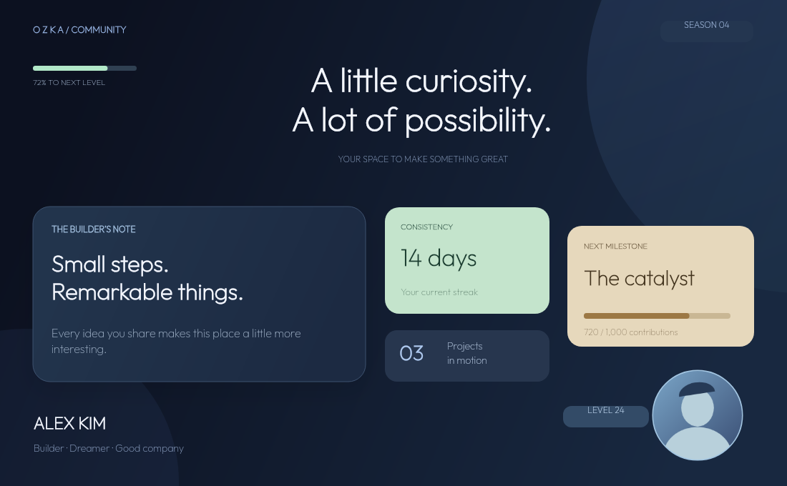

# ozka.js

**Discord development, without the limitations of yesterday.**

[npm package](https://www.npmjs.com/package/ozka.js) · [Get started](docs/QUICKSTART.md) · [Documentation](docs/README.md) · [Examples](docs/EXAMPLES.md)

An independent TypeScript Discord runtime with its own Gateway, REST scheduler, commands, interactions and UI engine. No discord.js runtime dependency. Discord.js, Eris and Oceanic are development-only benchmark subjects.

**0.1.0-alpha.1 is published on npm.** This is a working, tested initial implementation. It has not been tested with a live Discord bot or subjected to a production soak test. APIs may change during alpha. See [implementation status](docs/STATUS.md) before adopting it for a production bot.

## Install the alpha

```sh
npm install ozka.js@alpha
# Optional graphics backend
npm install @napi-rs/canvas
```

## Build and run locally

For a new bot project, follow the [step-by-step quickstart](docs/QUICKSTART.md): install the package, configure your Discord app, create `.env`, and run the [JavaScript starter](examples/quickstart.mjs). The commands below are for developing this library from its source repository.

Requires Node.js 22+ and npm. From this directory:

```sh
npm ci
npm run check
npm run demo
npm pack
```

`npm pack` creates a local installable tarball, including ESM exports, source maps and generated TypeScript declarations. To use a local build from another project, install that tarball.

```sh
npm install /path/to/ozka.js-0.1.0-alpha.1.tgz
# Optional: install graphics only if your bot renders canvas UI
npm install @napi-rs/canvas
```

```js
import { Ozka, UI } from 'ozka.js';

const bot = new Ozka({
  token: process.env.DISCORD_TOKEN,
  registerCommands: { guildId: process.env.DISCORD_GUILD_ID },
});

bot.command('ping', (ctx) => ctx.reply('Pong!'));
bot.command('help', (ctx) =>
  ctx.reply(
    UI.message()
      .text('## Welcome to Ozka\nNative Discord UI, with less ceremony.')
      .button('Explore', 'help:explore'),
  ),
);
bot.component('help:explore', (ctx) => ctx.update(UI.message().text('You’re ready to build.')));
await bot.start();
```

Set an actual guild ID for fast development registration, or use `registerCommands: true` for global commands. Registration upserts the commands you declare; it does not bulk-delete other commands. Invite the bot with `bot` and `applications.commands` scopes and appropriate channel permissions. `Guilds` is the default intent; slash commands need no Message Content intent.

## Three ways to build UI

**Native:** declarative components map to real Discord payloads. Containers, sections, text displays, galleries, thumbnails, separators, files, traditional embeds, buttons, all select types, modals, text inputs, uploads, radio groups and checkboxes are supported. Layout validation runs before transport.

```js
UI.message().add(
  UI.container(
    [
      UI.section(
        ['## Your workspace', 'Choose what to do next.'],
        UI.thumbnail('https://cdn.example.com/avatar.png'),
      ),
      UI.separator(),
      UI.row(UI.button('Projects', 'projects'), UI.link('Docs', 'https://example.com/docs')),
    ],
    { accent_color: 0x9dbaff },
  ),
);
```

**Free position:** real graphics are rendered into PNG attachments. Coordinates are relative to the parent; percentages, nested boxes, flow layouts and scaling are supported. Images are supplied as PNG/JPEG bytes or resolved asset IDs. No whitespace-based layout.

```js
const design = UI.canvas({ width: 1000, height: 600, background: '#10121a' });
design.add(
  UI.card({
    x: 40,
    y: 40,
    width: 450,
    height: 200,
    title: 'Profile',
    description: 'Welcome to ozka.js',
  }),
  UI.text('Make it your own.', {
    x: '50%',
    y: 280,
    width: 600,
    height: 60,
    anchor: 'center',
    align: 'center',
    fontSize: 32,
  }),
  UI.progress({ x: 40, y: 400, width: 600, value: 75 }),
);
await ctx.reply(UI.message().canvas(design).button('Settings', 'settings'));
```

**Hybrid:** a deterministic capability planner separates native content from positioned visuals. It returns valid media and controls, with explanations where Discord cannot reproduce a requested control position. It is not an LLM or a promise of pixel-perfect native layouts.

```js
const message = UI.hybrid({
  canvas: { width: 800, height: 400 },
  children: [
    '## A native heading',
    UI.card({ x: 30, y: 40, width: 500, height: 230, title: 'Free position' }),
    { control: UI.button('Open', 'open'), x: 200, y: 200 },
  ],
});
const prepared = await message.build();
console.log(prepared.explanations);
```

The button above is a native control beneath the image. Discord cannot place live clickable controls inside an arbitrary bitmap. Components V2 cannot contain ordinary embeds; Ozka raises an explicit error for that combination. `.content()` becomes a Text Display when using V2. `.mode('legacy')` uses an image embed for the canvas instead.



The complete [showcase source](examples/showcase.ts) builds this composition; [profile-bot.ts](examples/profile-bot.ts) sends it inside Discord with native controls. See [UI guide](docs/UI.md) for fonts, images, custom themes, reactive views and persistence.

## Included templates

`templates.profile`, `ticket`, `moderation`, `music`, `xp`, `leaderboard`, `poll`, `server`, `inventory`, `shop`, `help`, `settings`, `welcome`. Visual templates accept themes, dimensions, controls and a `decorate(scene)` hook. Native templates accept content, accent themes and controls. Font and arbitrary position changes apply to rendered UI; native Discord typography is controlled by Discord. Shop templates use actual premium SKU buttons and do not implement payments or fake purchase interactions.

## Verification and performance

```sh
npm run check      # build, declaration/type checks, unit/integration/payload/PNG tests
npm run demo       # PNG and corresponding Discord payload
npm run bench      # repeatable local comparisons; requires OpenSSL
```

[Measured results](benchmarks/RESULTS.md) include raw samples, environment, CPU, sampled allocations, startup, idle memory, public event dispatch, bounded-cache operations and local HTTPS latency. The showcase renderer and Ozka's protocol receiver also have dedicated measurements. These are simulated and loopback workloads. No general performance advantage is claimed.

## Documentation

- [Documentation index](docs/README.md)
- [Your first bot: complete quickstart](docs/QUICKSTART.md)
- [API reference](docs/API.md)
- [Runnable examples](docs/EXAMPLES.md)
- [Troubleshooting](docs/TROUBLESHOOTING.md)
- [Getting started, commands, events and interactions](docs/GUIDE.md)
- [Native, canvas, hybrid and reactive UI](docs/UI.md)
- [Performance, sharding and diagnostics](docs/PERFORMANCE.md)
- [Migration from discord.js](docs/MIGRATION.md)
- [Architecture, extensions and security](docs/ARCHITECTURE.md)
- [Implementation status and release gates](docs/STATUS.md)
- [Benchmark methodology](benchmarks/README.md)
- [Contributing](CONTRIBUTING.md)
- [Changelog](CHANGELOG.md)

## Discord references

Implementation checked against the official [Gateway](https://docs.discord.com/developers/events/gateway), [rate limits](https://docs.discord.com/developers/topics/rate-limits), [components](https://docs.discord.com/developers/components/reference), [interactions](https://docs.discord.com/developers/interactions/receiving-and-responding), [application commands](https://docs.discord.com/developers/interactions/application-commands) and [Discord API documentation repository](https://github.com/discord/discord-api-docs). Wire types come from `discord-api-types` through type-only imports. That package has no runtime import in compiled Ozka code.

MIT licensed. The bundled Outfit example font has its own OFL license in `examples/assets/OFL.txt`.
